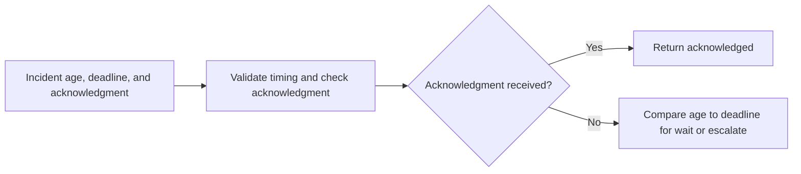

# PagerDuty Escalation Agent

Offline decision helper for incident acknowledgment and escalation.

Run `python3 agent.py --age 8 --deadline 5` to produce `escalate`. The helper makes a recommendation without contacting PagerDuty or sending notifications.

## Local verification

Run `make verify` with Make and Python 3 installed. The target runs the documented sample through the project CLI.

## Business problem

A responder needs a consistent decision on whether an unacknowledged incident has reached its escalation deadline.

## Project walkthrough



[Architecture and data flow](docs/ARCHITECTURE.md) · [Business problem, demo, and verification](docs/CASE_STUDY.md)

## Run the project

### Local setup

Run `make verify` with Python 3 and Make installed.

### CLI usage

```sh
python3 agent.py --age 8 --deadline 5
```

### Replay usage

Run `make replay` to replay the checked-in inputs. The runner compares stdout with the baseline, reports differences, and exits nonzero on regression.

[Replay cases](examples/replay-manifest.json) · [Generated report](reports/replay.md) · [Rule implementation](docs/RULES.md)

### Run tests

[Verification report](reports/verification.md) · [Business problem, sample behavior, and limitations](docs/CASE_STUDY.md)


### Limitations

The verification report covers the bundled local examples. See the [case study](docs/CASE_STUDY.md) for project-specific assumptions and operating limits.

## Development and security

See the [developer setup, tool roles, and security checks](docs/DEVELOPMENT.md).

[Local check results](reports/devsecops.md)

## Runbook

[Run, verify, and troubleshoot this project](docs/RUNBOOK.md)
