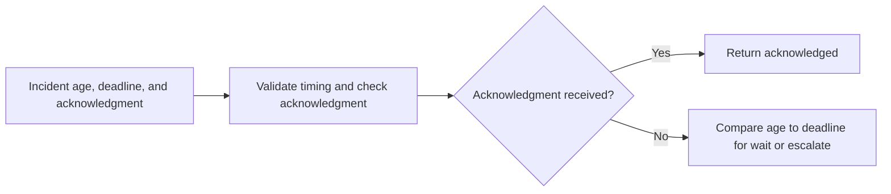

# PagerDuty Escalation Agent

A responder needs a consistent decision on whether an unacknowledged incident has reached its escalation deadline.

[Skills and verification](docs/ENGINEERING_NOTES.md)

## What I built

I built a PagerDuty-style decision CLI that validates the incident age and deadline, prioritizes acknowledgment status, and recommends wait or escalate based on the deadline.

## How it works



[Architecture](docs/ARCHITECTURE.md) · [Decision rules and source](docs/RULES.md)

## Tools used

| Tool | Role in this repository |
| --- | --- |
| Python | [agent.py](agent.py) implements the CLI and decision rules. Uses `argparse` to parse command-line options. |
| Make | Runs the documented example and local checks. |
| Python replay runner | Compares actual stdout with the checked-in baseline fixtures. |
| Ruff and Bandit | Developer lint and static security checks through `make check`. |

## Run the project

Use Python 3.10+ and Make. From the repository root:

```sh
python3 agent.py --age 8 --deadline 5
```

The sample recommends escalation at age eight with a five-minute deadline. The acknowledged scenario suppresses escalation. [Full expected output](examples/Demo%201.stdout.txt)

### Additional replay cases

- **Acknowledged incident** · `python3 agent.py --age 8 --deadline 5 --acknowledged` · [Expected output](examples/Acknowledged%20incident.stdout.txt)

## Verify the project

```sh
make verify
make replay
```

`make replay` checks the recorded cases and exits nonzero if the output changes.
See the [developer guide](docs/DEVELOPMENT.md) for the pinned lint and security tools.

## Operating limits

The decision uses CLI inputs. The lab does not contact PagerDuty or send a page.

[Case study](docs/CASE_STUDY.md) · [Operator runbook](docs/RUNBOOK.md) · [Verification report](reports/verification.md)
