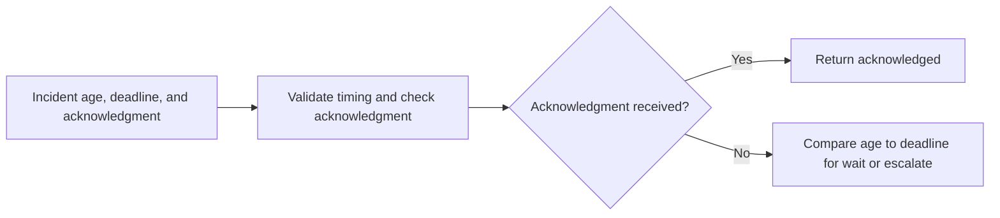

# PagerDuty Escalation Agent

Offline decision helper for incident acknowledgment and escalation.

Run `python3 agent.py --age 8 --deadline 5` to produce `escalate`. The helper makes a recommendation without contacting PagerDuty or sending notifications.

## Local verification

Run `make verify` with Make and Python 3 installed. The target runs the documented sample through the project CLI.

## Business problem

A responder needs a consistent decision on whether an unacknowledged incident has reached its escalation deadline.

## Project walkthrough

[Architecture and data flow](docs/ARCHITECTURE.md) · [Business problem, demo, and verification](docs/CASE_STUDY.md)
