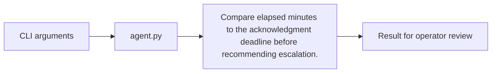

# Pagerduty Escalation Agent architecture

Offline decision helper for incident acknowledgment and escalation.

## Operational boundaries

The documented run evaluates the bundled sample locally. Results depend on the quality and scope of the input. The demo makes no live infrastructure changes.
